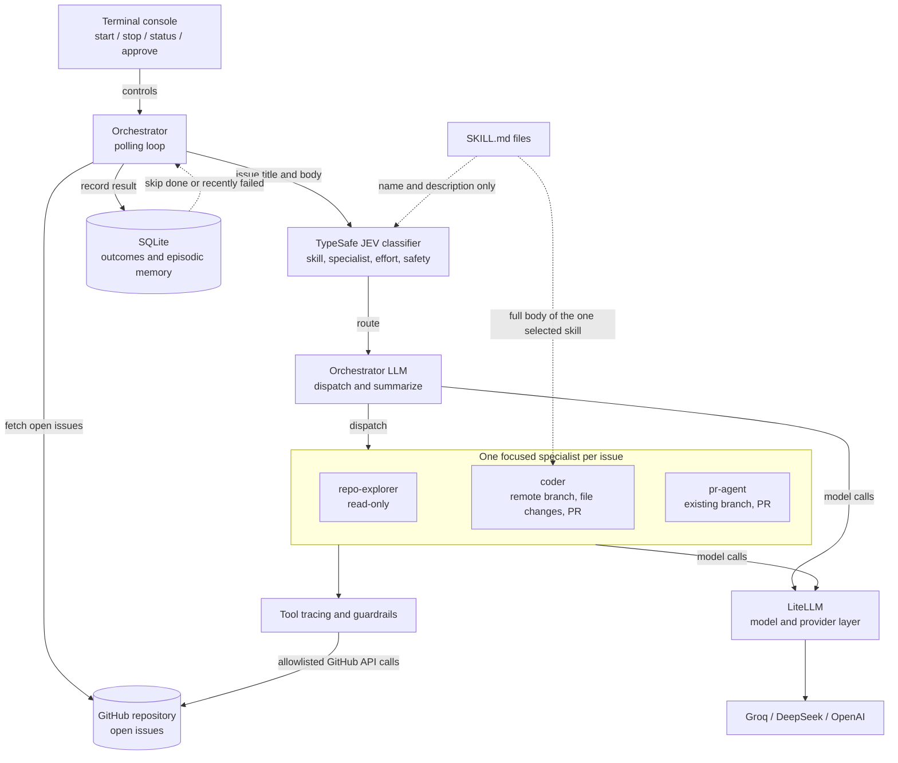
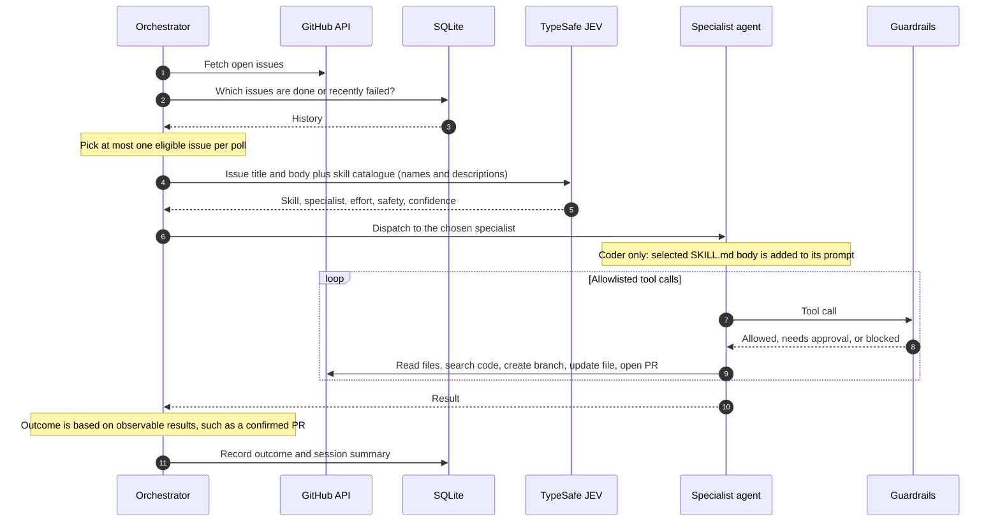
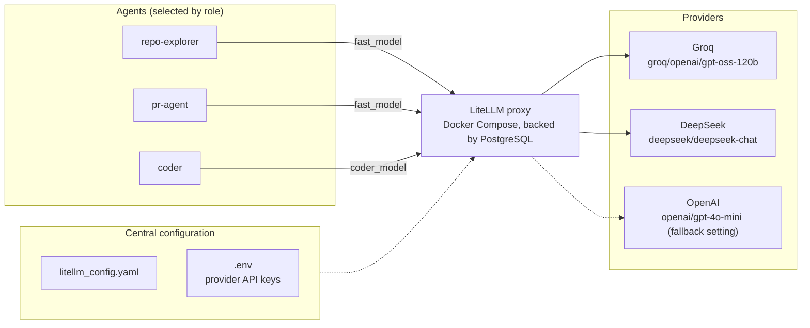
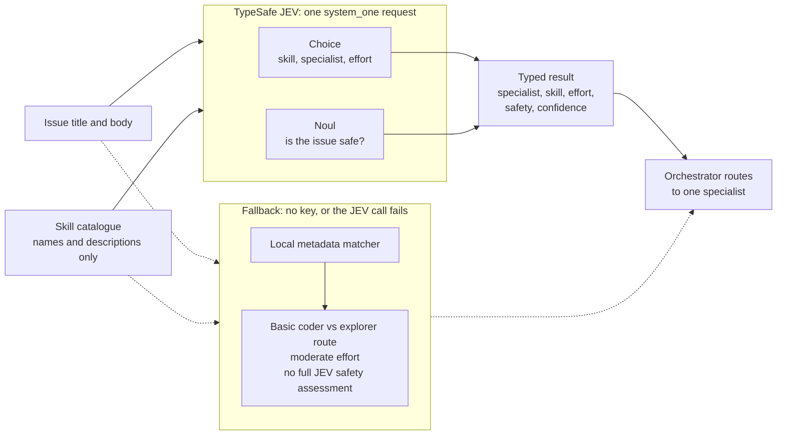
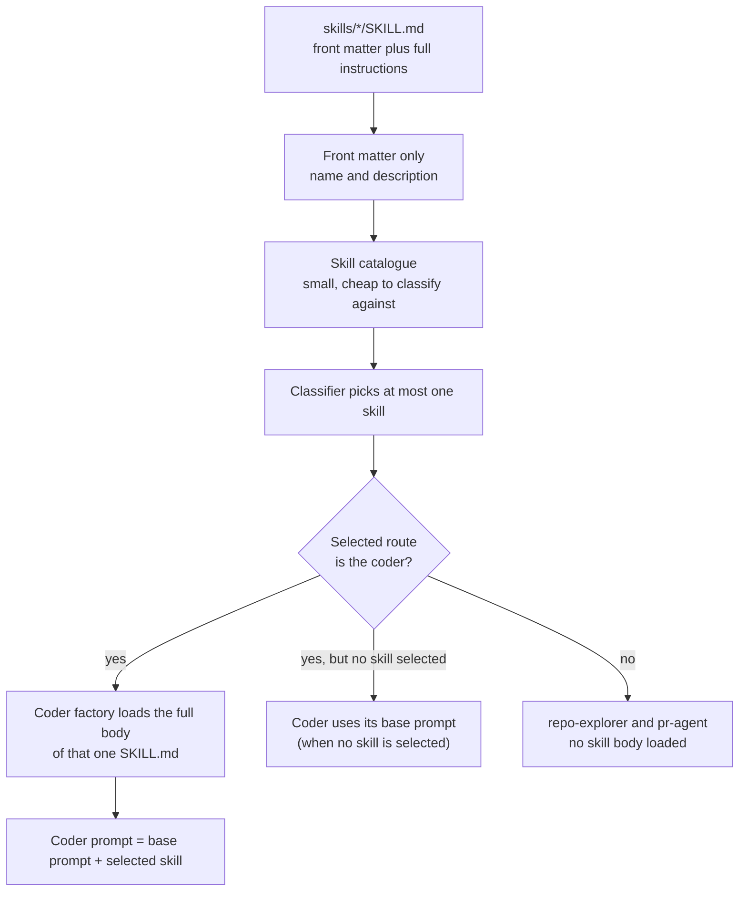
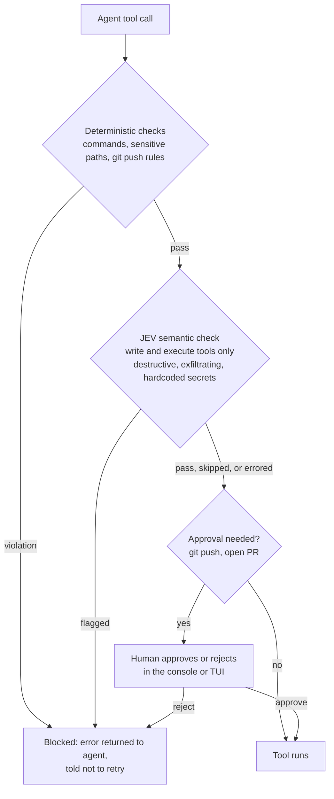

# Code Buddy

Code Buddy is a Python service that polls a GitHub repository for open issues, classifies each eligible issue, and routes it to a focused AI specialist. The specialists can investigate the repository, make a change on a remote branch, or open a pull request for an existing branch. A terminal console controls the polling service, and SQLite keeps issue outcomes and episodic summaries.

The project is designed around bounded, purpose-specific agents and GitHub API operations. It is not a general-purpose local coding assistant: the orchestrator has no repository-editing tools, and the coder is instructed to work through the GitHub API rather than local shell or Git commands.

## Contents

- [Architecture at a glance](#architecture-at-a-glance)
- [How one issue flows through the system](#how-one-issue-flows-through-the-system)
- [Issue lifecycle](#issue-lifecycle)
- [Agents and GitHub tool boundaries](#agents-and-github-tool-boundaries)
- [Model routing and LiteLLM](#model-routing-and-litellm)
- [TypeSafe JEV classification](#typesafe-jev-classification)
- [Selective skill loading](#selective-skill-loading)
- [Guardrails and approvals](#guardrails-and-approvals)
- [Persistence, observability, and limits](#persistence-observability-and-limits)
- [Run the terminal console](#run-the-terminal-console)
- [Run with Docker Compose](#run-with-docker-compose)

## Video recording link : [Click here to watch the project demo video](URL_TO_YOUR_VIDEO)


## Architecture at a glance

Four ideas keep the system small, cheap, and predictable:

| Idea | What it does | Why it helps |
| --- | --- | --- |
| **TypeSafe JEV** | One structured call picks the skill, specialist, effort, and safety result | Routing decisions are typed and cheap; the coding LLM is not used for classification |
| **LiteLLM** | One model/provider layer for all agents, configured centrally | Swap a provider or model in config, not in agent code |
| **Selective skill loading** | Only the selected `SKILL.md` is loaded, and only for the coder | Smaller prompts, less irrelevant context |
| **Scoped tools and guardrails** | Each agent gets an allowlisted GitHub toolset; every tool call passes through middleware | Agents can only do what their role needs |



The main implementation is under `src/`: `orchestrator/` manages the issue lifecycle, `classifier/` chooses the route, `agents/` creates specialists, `github/` exposes scoped repository tools, `guardrails/` checks tool actions, `skills/` selects task-specific workflows, and `memory/` persists issue history. `src/tui/` implements the interactive console.

## How one issue flows through the system



## Issue lifecycle

1. Run the console and start polling. The orchestrator polls immediately, then waits for the configured interval.
2. Code Buddy fetches open issues and skips issues that are already in progress, completed, or recently failed within the configured history lookback. It handles at most one eligible issue per poll.
3. The classifier evaluates the issue title and body and returns a specialist, an optional skill, an effort estimate, a safety result, and confidence.
4. The orchestrator receives the issue details and dispatches to a specialist. It is intended to route and summarize, not to read or change repository files itself.
5. The specialist uses only its allowlisted GitHub tools. Tool tracing records calls and elapsed time; guardrail middleware checks applicable actions.
6. The issue outcome is based on observable results, such as a confirmed PR creation or a read-only investigation dispatch, rather than trusting the orchestrator's prose summary alone. The result and a session summary are recorded in SQLite.

The orchestrator prompt allows another specialist dispatch when the first is blocked and another specialist can help. The dispatch recorder records specialist calls; the prompt's dispatch limit is not an independent hard runtime limit.

## Agents and GitHub tool boundaries

| Agent | Purpose | Tools and boundaries |
| --- | --- | --- |
| Orchestrator | Choose and coordinate the specialist; report the result | No ordinary repository tools; uses the subagent/task mechanism |
| repo-explorer | Answer read-only repository questions | Main-branch/directory overview, GitHub file reads, and code search; no writes or PR tools |
| coder | Implement a requested change and open a PR | Creates a remote `codepilot/issue-<number>-fix` branch, reads/creates/updates files, and opens a PR; no local shell/Git workflow |
| pr-agent | Open a PR for changes already on a branch | Lists/selects branches and creates a PR; no file editing or shell tools |

Tool sets are built from GitHub's API toolkit and explicitly allowlisted for each role rather than exposing the full toolkit to every agent. The coder's `update_file` validates repository-relative paths, rejects absolute paths and `..`, checks protected paths, requires an active non-base branch, and limits a tool-set instance to one successful update per path. Updates provide the complete final file contents. The coder is prompted to create its branch before making changes and to open a PR that closes the issue.

## Model routing and LiteLLM

The application separates model choice by agent role, so routine repository-reading and PR coordination can use a fast tier while code implementation uses its coder tier.



Current defaults are:

| Setting | Default | Used for |
| --- | --- | --- |
| `fast_model` | `groq/openai/gpt-oss-120b` | Repo explorer and PR agent |
| `coder_model` | `deepseek/deepseek-chat` | Coder |
| `fallback_model` | `openai/gpt-4o-mini` | Configured fallback model |

These are provider/model identifiers, not a guarantee that a provider's service is free. Pricing, free quotas, availability, and rate limits depend on the provider and account. The split keeps the more expensive or capable coding model focused on implementation while simpler specialist work can use a different tier. The current agent factories select models by role; although the classifier also estimates effort, effort-based model switching and per-effort call budgets are not currently enforced in the runtime path.

LiteLLM is used as the common model/provider configuration layer. Model identifiers and provider API keys are configured centrally in `litellm_config.yaml` and environment variables; the Docker Compose setup includes a LiteLLM proxy and configures Code Buddy to reach it. This gives the project a consistent interface across providers, allows a provider/model to be changed in configuration rather than agent code, and makes it possible to centralize proxy-side model administration. The configured model list currently includes Groq GPT-OSS models and DeepSeek Chat. The fallback model setting is present in application settings; verify that a model is also available in the proxy configuration before selecting it.

Application settings also define timeout, retry, budget-per-issue, and repository-map token-budget values. Do not treat the budget setting or the separately defined tracing call limits as an enforced per-issue model-call cap: the current agent factories attach tool tracing and guardrails, but do not attach the model-call limit middleware.

### Configuration

Copy `.env.example` to `.env` and provide the GitHub App credentials, repository, and provider credentials required by the selected models. For TypeSafe classification and semantic guardrail checks, configure `TYPESAFE_API_KEY` as well. The relevant settings include:

| Variable/setting | Purpose |
| --- | --- |
| `GITHUB_APP_ID`, `GITHUB_APP_PRIVATE_KEY`, `GITHUB_REPOSITORY` | GitHub App ID, host path to its PEM file (Docker), and target repository |
| `GROQ_API_KEY`, `DEEPSEEK_API_KEY`, `OPENAI_API_KEY` | Provider credentials for configured model tiers |
| `TYPESAFE_API_KEY`, optional `TYPESAFE_MODEL` | TypeSafe JEV classification and semantic checks; default model is `jev-1.13.0` |
| `CODER_MODEL`, `FAST_MODEL`, `FALLBACK_MODEL` | Role model overrides |
| `LITELLM_PROXY_URL`, `LITELLM_PROXY_KEY` | Proxy endpoint and key used by the Compose deployment |
| `POLL_INTERVAL_MINUTES`, `AUTO_APPROVE_PUSH` | Polling cadence and push approval policy |
| `DATA_DIR`, `EPISODIC_LOOKBACK_SESSIONS` | SQLite/runtime data location and failed-issue lookback |

Use `.env.example` and `src/config/settings.py` as the source of truth for required names and defaults. Keep real credentials out of source control.

## TypeSafe JEV classification

TypeSafe JEV is used as a lightweight structured decision layer around the agent workflow; it is not the model that writes code. With `TYPESAFE_API_KEY` configured, `classify_issue()` makes one `system_one` request that evaluates several typed outputs together:

- `Choice` selects the relevant skill, specialist (`coder`, `repo-explorer`, or `pr-agent`), and effort (`simple`, `moderate`, or `complex`).
- `Noul` estimates whether the issue is safe.



Combining these decisions in one classification request avoids separate classification calls for each decision and keeps the result structured for routing. The issue classifier reads skill names and descriptions only, not the full skill instructions. If the TypeSafe key is absent, a local metadata matcher selects a skill and derives a basic coder-versus-explorer route. If the JEV classification call fails, the classifier logs a warning and falls back to that local matcher; the fallback uses moderate effort and does not provide the full JEV safety assessment. Consequently, JEV improves routing efficiency and avoids using the coding LLM for those classification decisions, but it does not eliminate the separate LLM calls needed to perform the actual task.

## Selective skill loading

Skills live as `SKILL.md` files. Code Buddy avoids adding every skill's full instructions to every agent prompt:

1. The classifier builds a catalogue from each skill's YAML front matter (name and description only).
2. It selects at most one relevant skill for an issue.
3. Only when the selected route is the coder does the coder factory load that skill's full body and append it to the coder prompt.
4. Read-only and PR-management work does not receive an irrelevant coding workflow; other agents do not get all skill bodies.



This reduces prompt size and irrelevant context while preserving detailed, task-specific instructions for the agent that needs them. If no suitable skill is selected, the coder uses its base prompt.

## Guardrails and approvals

Tool calls pass through middleware that applies deterministic checks and, when available, TypeSafe JEV semantic checks:



- Command patterns block recursive/forced deletion, selected Windows deletion commands, remote/network utilities such as `curl`, `wget`, `ssh`, and `scp`, and package installation commands.
- Sensitive-path patterns protect `.env`, `.secret`, `.pem`, `.key`, and `credentials` paths for file tools. The same path check is applied to command text when an `execute` tool is used.
- Git pushes are rejected if they are force pushes, target `main` or `master`, or do not target a `codepilot/*` branch. Otherwise they require approval unless `AUTO_APPROVE_PUSH` is enabled.
- Opening a GitHub pull request also requires approval. The console provides the approval prompt; the TUI can supply its own approval handler.
- Write and command-execution tools can be checked by JEV for destructive or exfiltrating behavior and hardcoded secrets. The payload is capped at 4,000 characters for this check.

When the TypeSafe key is missing, the JEV semantic check is skipped; if that check raises an exception, the error is debug-logged and the action proceeds to the remaining checks. The deterministic command/path checks and applicable human approval gates are separate from that semantic check. A blocked tool call returns an error to the agent and instructs it not to retry the action.

## Persistence, observability, and limits

- SQLite stores completed issue identifiers, failed outcomes/session summaries, and episodic history. Recent failures are considered during polling so the same issue is not immediately retried on every cycle.
- Tool tracing records tool start, completion/failure, and elapsed time. LangSmith tracing hooks are available when configured.
- Work is performed through GitHub API tools on remote branches. Local shell Git commands do not select the remote branch used by the coder.
- A successful PR callback and read-only investigation dispatch are used as observable completion signals. A change task without a confirmed PR is not considered complete.
- Existing model-call limit helpers and effort estimates should not be confused with enforced runtime limits; the active runtime path currently does not attach model-call-limit middleware or per-subagent recursion caps.

## Run the terminal console

From the repository root:

```powershell
uv run python main.py
```

The console uses normal terminal scrollback. Enter `help` to see commands such as `start`, `stop`, `status`, `history`, `logs`, and `quit`. Use `approve` or `reject` when a guarded action requests confirmation.

## Run with Docker Compose

On first use, copy `.env.example` to `.env` and fill in the GitHub and
model-provider configuration. Set `GITHUB_APP_PRIVATE_KEY` to the full path
of your GitHub App PEM file on the host. On Windows, use forward slashes,
for example `C:/Users/you/keys/github-app.pem`. Compose mounts that file
read-only at `/app/github-app.pem` and passes the container path to the GitHub
client, which reads the PEM contents from the file. Keep the PEM file outside
the repository.

After that setup, start Code Buddy interactively with one command from the
repository root:

```powershell
docker compose run --build --rm code-buddy
```

`docker compose run` keeps stdin attached and allocates a terminal for the
interactive console. It builds the Code Buddy image and starts the
LiteLLM/PostgreSQL dependencies automatically. Type `help` to see commands,
then `start` to begin polling. Stop Code Buddy with `Ctrl+C`; the one-off
application container is removed automatically, but its dependencies may
remain running. Run `docker compose down` to stop those services while
retaining the SQLite and LiteLLM database volumes.

`docker compose up --attach code-buddy` is useful for following service logs,
but may not forward keyboard input to the console. Do not use it when you need
to type interactive commands.
